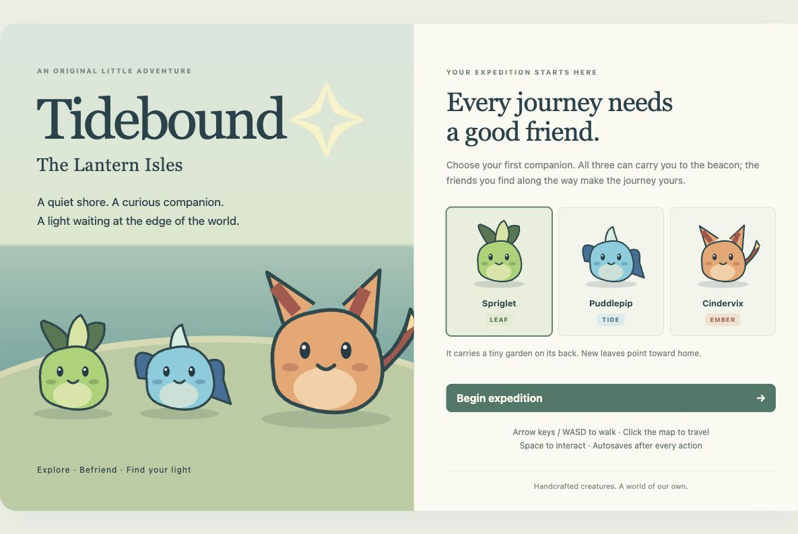
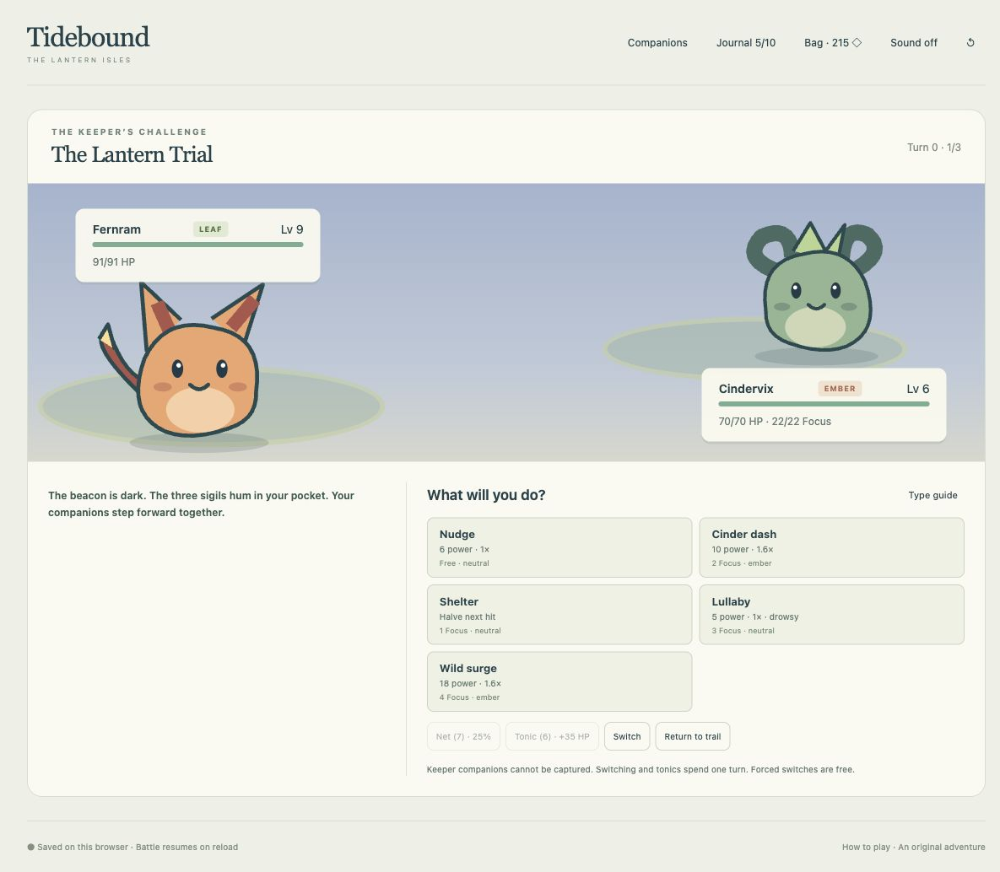
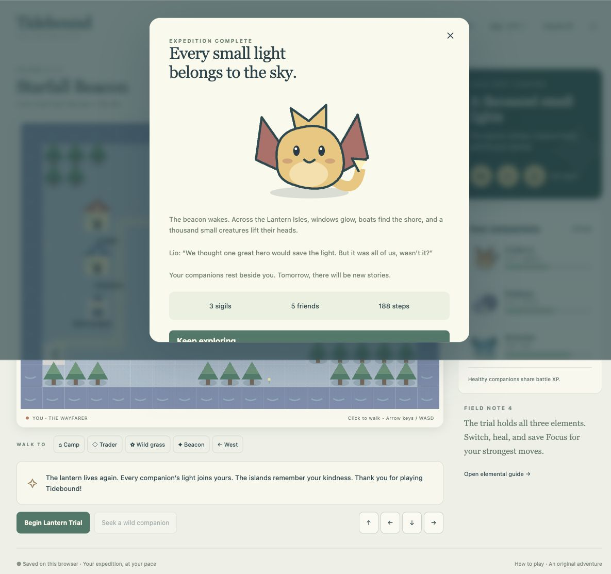

# Tidebound — The Lantern Isles
A compact original creature-collecting RPG about finding your light. Ten handcrafted illustrated companions, three starters, four connected islands, a rival, three elemental wardens, and a final three-stage Lantern Trial. Inspired by the adventure and collecting loop of classic handheld RPGs; all names, creatures, art, world, dialogue and sound are original.



## Play on this Mac
The local game is at **http://127.0.0.1:5181/**. A session-only Vite process was started with the supported terminal tool; no startup/login service was installed. The server may stop when the host session ends or the Mac restarts. To restart:

```sh
cd /Users/intrepion/Documents/Codex/2026-10-10/task-9/kata-inspired-by-pokemon-blue-codex-dot
npm ci
npm run dev
```

Port 5181 is strict: it fails if occupied rather than taking an existing server’s port. Ports 5173–5180 were left alone. Localhost is available on this Mac only; no public deployment. Save data belongs to the current browser/origin, persists across refreshes and server restarts, and can be replaced with the in-game new-expedition confirmation. The verification playthrough was reset through normal controls, leaving a clean starter screen.

## Controls and strategy
Arrow keys / WASD or the on-screen dpad move. Click the map or a destination button to walk along a valid path; wild encounters interrupt travel. Space interacts. Visit the red camp to rest, blue trader to shop, northeast warden to earn a sigil, and east crossing to continue. Use Companions to choose your leader and switch during battle. Captures beyond the three-member party go to sanctuary; swap at camp. Sanctuary holds 1,000 companions, and full-capacity capture never spends a net.

Leaf beats Tide, Tide beats Ember, Ember beats Leaf. Strength 1.6×, resistance 0.65×. Nudge is free; elemental moves use Focus. Shelter halves one hit; Lullaby unlocks at level 4 and weakens two attacks; Wild surge unlocks at level 6. Healthy party members share XP. Free camp rest restores health/Focus and tops supplies up to 3 nets / 2 tonics. Defeat returns you safely to camp. Audio is opt-in synthesized original cues, not a soundtrack.

## Verification
```sh
npm test
npm run typecheck
npm run build
npm audit --audit-level=high
```

22 automated behavioral tests cover seeded turns, damage/type effects, Focus, status, Shelter, capture/failed capture/odds, full party/sanctuary capacity, items, switching/forced switches, defeat/recovery, atomic shop transactions, gates, rewards, level-up, corruption validation and deterministic battle save resumption. Both fixture-based battle balance simulations and command-driven crossing campaigns complete from every starter. Tests operate through newGame/act/encodeSave/decodeSave; simulations are separate from browser evidence.

Actual Mac Chrome campaign completed with Cindervix and visible normal buttons/keyboard. Rival, all wardens, finale and ending, captures including full-party sanctuary routing, swap, purchases, rest, Lullaby/tonics, voluntary/forced switch, deliberate loss/recovery, interrupted-battle reload and ending persistence verified. Ending recorded 188 steps and 5 species befriended. Responsive 390×844 desktop Chrome viewport covered exploration, combat, journal and starter screen; no physical mobile device or other browser engine coverage claimed. Original audio toggle exercised; acoustic quality not measured. [Detailed QA and independent review](docs/QA.md).

## Engineering and provenance
Strict TypeScript, Vite, Vitest, no runtime dependencies/network/assets/services. One pure synchronous command reducer with seeded random state; rendering never awards resources. Version1 saves include exact battle state and are validated before use. Corrupt saves are rejected with a visible recovery message, without running supplied HTML. [Acceptance criteria](docs/SPEC.md), [glossary](GLOSSARY.md), [architectural decision](docs/adr/0001-command-state-and-save.md), [Matt Pocock skills and delegated adaptations](docs/WORKFLOW.md). Independent specification and standards reviews ran separately; all blocking findings resolved.

Private repository: https://github.com/intrepion/kata-inspired-by-pokemon-blue-codex-dot. CI tests, builds/typechecks and audits every push. The folder is cloned on the Mac; no unsupported sidebar registration was attempted.



